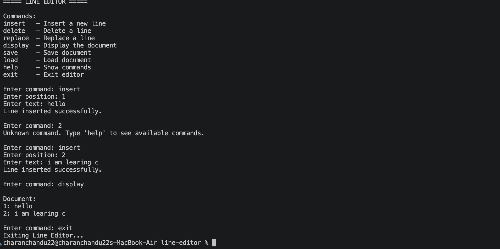

# Line Editor

## Project Description

Line Editor is a command-line text editor developed using the C programming language.

It allows users to create and manage a simple text document using commands.

## Features

- Insert a new line
- Delete a line
- Replace a line
- Display the document
- Save the document
- Load the document
- Help command
- Exit the editor
- Invalid position handling

## Technologies Used

- C Programming Language
- GCC Compiler
- VS Code
- macOS Terminal

## Project Structure

```text
line-editor/
│
├── main.c
├── line_editor
├── document.txt
├── HELP.md
└── README.md

## Program Output


